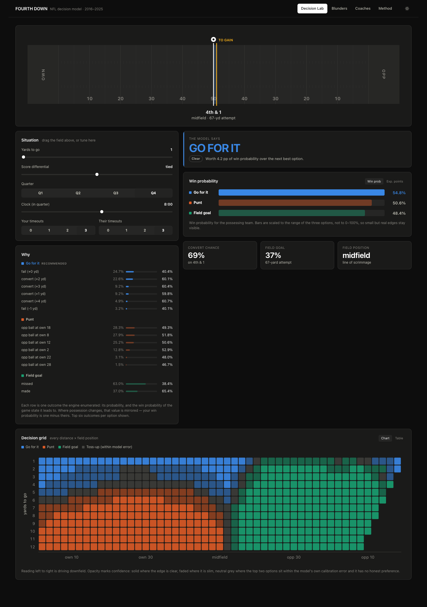
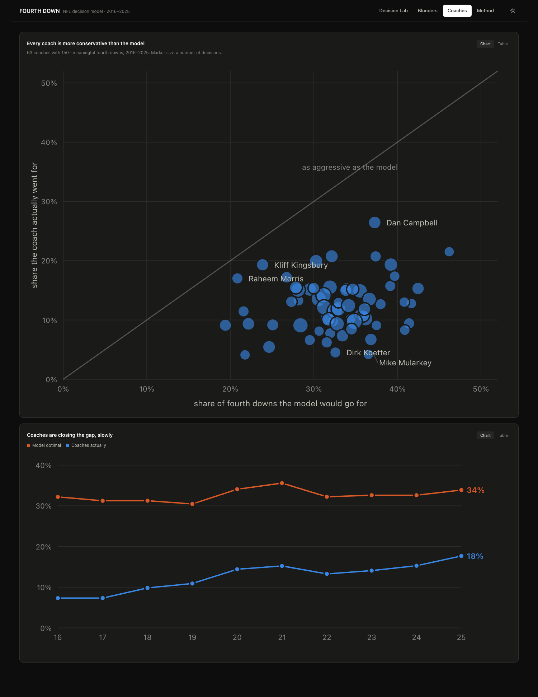
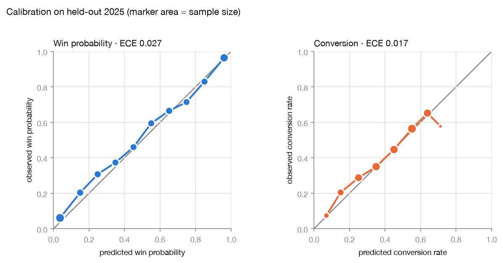

# Fourth Down

A counterfactual expected-points and win-probability model for NFL fourth-down
decisions, built on ten seasons of play-by-play, with an interactive dashboard.

For every fourth down since 2016 it answers: **what should the coach have
done, and what did the actual call cost?**



---

## The finding

Coaches are wrong in exactly one direction, and it is expensive.

| Model recommends | Decisions | Coach agreed | Win probability lost per decision |
|---|---|---|---|
| Punt | 11,182 | **97.6%** | 0.06 pp |
| Field goal | 6,967 | 84.2% | 0.32 pp |
| **Go for it** | 8,774 | **29.7%** | **1.25 pp** |

When the model says punt, coaches punt essentially always. When it says go for
it, they punt anyway 57.5% of the time — and that mistake costs about twenty
times more than the punt-side mistake.

**Not one of the 63 coaches with 150+ decisions is as aggressive as the model.**
The aggression index (actual go-rate ÷ optimal go-rate) runs from 0.11 to 0.82.
None exceeds 1.0.



Coaches have moved — the league go-rate rose from 7.3% in 2016 to 17.7% in
2025, cutting the average cost of a fourth-down call from 0.61 pp to 0.44 pp.
They are still going for it about half as often as they should.

---

## Why this is not a classification problem

Play-by-play records what coaches **did**, never what they **should** have
done. There is no ground-truth label for a correct decision.

Training a classifier on coach decisions produces a coach *imitator* — and
since NFL coaches are measurably too conservative on fourth down, that model
would faithfully reproduce a known mistake and call it a prediction. The whole
question being asked is whether the observed behaviour is right, so the
observed behaviour cannot also be the target.

So this is framed the way Romer (2006), the NYT 4th Down Bot, and Ben Baldwin's
model frame it — as **decision theory**. Model the outcomes of each action,
value the resulting game states, take the argmax:

```
EV(action) = Σ  P(outcome) × V(state after outcome)
```

Four models feed that sum:

| Component | Predicts | Trained on |
|---|---|---|
| **State value** | next score (7-class → EP) + eventual winner (→ WP) | 384,418 plays |
| **Go** | full distribution of yards gained, in 32 bins | 76,371 third/fourth-down attempts |
| **Punt** | distribution of where the receiving team starts | 22,514 punts |
| **Field goal** | make probability, per-kicker | 10,731 attempts |

Two conventions carry the arithmetic. `yardline_100` always counts yards to
the end zone the team *with the ball* is attacking, so a change of possession
mirrors the field, negates the score differential, and swaps timeouts. And
win probability is zero-sum: `WP(us) = 1 − WP(them)`.

Expected points needs one extra rule. EP measures the *next* score, so once a
branch scores, that score **is** the answer — adding the value of the ensuing
kickoff on top would double-count. Win probability has no such shortcut, which
is exactly why both exist. A worked example from the dashboard:

> **Up 2, 2:00 left, 4th & 4 at your own 40** — expected points says GO
> (−0.11 vs −1.11 for a punt). Win probability says **PUNT** (0.669 vs 0.652).

EP loves keeping the ball. WP knows that protecting a two-point lead with two
minutes left is worth more than field position. EP alone gives the wrong answer
in precisely the situations fourth downs matter most.

---

## Validation

Full report with figures: **[reports/validation.md](reports/validation.md)** ·
regenerate with `make report`.

Everything below is **held-out 2025** — a season no model trained on and no
hyperparameter was selected against. The split is temporal (train 2016–23,
validate 2024, test 2025) because a random play-level split leaks: every play
in a drive shares the same next-score label.

| Model | Metric | Result | Reference |
|---|---|---|---|
| Next score | log loss | **1.2961** | 1.5109 class-prior baseline |
| Expected points | MAE vs nflfastR | 0.432 pts | r = 0.9568 |
| Win probability | log loss | **0.4858** | nflfastR `vegas_wp` 0.4781 |
| Win probability | ECE | **0.0274** | — |
| Conversion | ECE | 0.0173 | AUC 0.699 |
| Field goal | Brier | 0.1146 | AUC 0.749 |



Three things worth pointing at:

**The label construction validates independently.** Expected points computed
straight from raw next-score outcomes matches nflfastR's fitted model at
**r = 0.9999, mean absolute difference 0.023 points** — two completely
separate constructions agreeing, which is what makes the fiddly cases
(safeties credit the *defense*, pick-sixes via `td_team`, PATs excluded so
touchdowns aren't double-counted) verifiably right.

**The gain model validates against something it never saw.** It is trained only
on binned yardage and never sees a convert/fail label — yet the conversion
probability implied by summing its bins above the sticks tracks the observed
rate to within 0.025 at every distance.

**We lose to `vegas_wp` on the test season** (0.4858 vs 0.4781). That is
reported rather than buried.

### The engine has no label, so its correctness is argued

`make sanity` asserts it — nine canonical situations the literature has settled,
plus structural monotonicity (going for it never gets *better* as yards-to-go
grows; a field goal never gets *worse* as the kick shortens). All pass; largest
monotonicity violation 0.0006 against a 0.005 tolerance.

---

## Things that went wrong, and what fixed them

These are in here because the debugging is most of the work.

**A feature with no variance nearly destroyed the model.** `dynamic_kickoff_era`
is 0 for every play in 2016–23 and 1 from 2024 on — constant in training,
set in validation. Standardizing divides by a std of zero, clamped to `1e-6`,
so every held-out row fed the first layer a feature value of **1,000,000**. EP
bias grew from +0.47 in 2024 to +1.44 in 2025 as more such flags switched on.
The preprocessor now drops zero-variance features loudly. The real lesson isn't
"clamp harder" — *you cannot learn the effect of a rule change that never
occurs in your training data.*

**The neural field-goal model was withdrawn.** It was well calibrated to 54
yards, then predicted 60% on 60–64 yard attempts that convert 41% of the time.
Only 98 of 10,731 attempts are past 60 yards, so cross-entropy barely noticed
them and the network flattened into a plateau — exactly where "kick or punt" is
a live question. It is now a logistic GLM with softplus-constrained slopes,
**monotone by construction** and asserted so in the training script. It costs
0.007 of log loss to remove a large structural error.

**An era artifact faked a finding.** Scoring each season under its own era
features made the *optimal* go-rate appear to climb from 14% to 34% — a great
headline, and false. Re-scoring one fixed set of 900 real 2019 situations under
different season labels swung the model's go-rate from 18.6% to 30.7% while the
underlying situation mix barely moved. All history is now scored at one
reference season. The optimal rate is flat near 32%; the movement is entirely
in coach behaviour, which is the real story.

**The same apples-to-oranges validation mistake, three times.** Comparing model
output at synthetic bin midpoints against pooled empirical rates. It made the
gain model look 0.06 off when it was 0.023, and made the field-goal model look
worse than it was. Every calibration check now runs on real rows with real
features.

**The model refuses to fake precision.** An early decision grid recommended GO
on 4th & 7 from your own 5. Chasing it down, both models turned out fine — the
GO/PUNT gap in those cells is 0.003 WP while the win-probability model's
calibration error is 0.027. The recommendation was noise wearing a confident
face. Margins under 0.005 WP now report as **toss-ups** (11,695 of 41,082
situations) and are excluded from the leaderboard entirely.

---

## Neural network vs. gradient boosting

nflfastR uses XGBoost, and on tabular data this size it is the model to beat,
not the one to feel clever for avoiding. Both were built. Held-out 2025:

| Task | Multi-task NN | XGBoost | Winner |
|---|---|---|---|
| Next score, log loss | 1.2961 | **1.2392** | XGB |
| Next score, accuracy | 44.2% | **46.3%** | XGB |
| Win probability, log loss | **0.4858** | 0.5154 | NN |
| Win probability, AUC | **0.8426** | 0.8260 | NN |
| Conversion, log loss | 0.6178 | **0.6108** | XGB |

**XGBoost wins the core classification task.** The honest headline.

The hypothesis behind the shared trunk was that conversion — the sparsest task
— would gain most from borrowing representation. **That was wrong**; it lost
there. The trunk's benefit showed up on win probability instead, and as a
*generalization* gap rather than a fit gap: on validation both sit near 0.418,
but on test XGBoost degrades to 0.5154 while the network only reaches 0.4858.
The boosters overfit season-specific structure that the shared trunk
regularizes against.

That is also a sample-size fact. `posteam_won` is a game-level label shared by
~190 plays, so the win-probability task has roughly **4,300 effective
independent samples, not 307,000**. Larger networks memorize game outcomes
almost immediately.

---

## The dashboard

Hand-rolled SVG rather than a charting library — the mark specs (2px lines,
hairline grids, ≥8px markers with 24px hit targets, selective direct labels)
are easier to hit directly than to negotiate with Recharts.

- **Decision Lab** — drag the football field to set the line of scrimmage;
  verdict, win-probability bars, and a panel showing every branch the engine
  enumerated with its probability and resulting value. Live decision-grid
  heatmap of all 558 distance × field-position combinations.
- **Blunders** — filterable ranked table, expandable rows.
- **Coaches** — the scatter above, plus the league trend.
- **Method** — how it works and what it doesn't know.

The categorical palette was checked with a validator rather than by eye, and
passes all-pairs in both themes. Every chart has a table-view twin, tooltips
enhance rather than gate values, and colour follows the entity so "go is blue"
survives every filter.

Views are deep-linkable (`#blunders`), and `?theme=dark|light` overrides the
stored preference.

---

## Quick start

```bash
./setup.sh                 # venv + deps + two macOS fixes (see below)
make data                  # pull 10 seasons, build labels        (~3 min)
make train-state           # multi-task EP/WP network             (~30 s)
make train-outcomes        # go / punt / field-goal models        (~1 min)
make score                 # score all 41k historical fourth downs (~2 min)
make report                # validation report + figures
make dashboard-build       # build the React app
make api                   # serve everything on :5001
```

`make all` runs the pipeline end to end. For frontend work, `make api` in one
terminal and `make dashboard` in another gives Vite hot reload with the API
proxied.

Other targets: `make sanity` (engine assertions), `make train-baseline`
(XGBoost comparison), `make dashboard-shots` (screenshot every view in both
themes and fail on console errors or overflow).

### Two macOS problems `setup.sh` handles

Both produce confusing failures, so they are scripted with the reasoning inline
rather than left as folklore.

**xgboost can't find OpenMP.** The wheel's `libxgboost.dylib` has exactly one
baked rpath, `/opt/homebrew/opt/libomp/lib`, which only exists with Homebrew.
PyTorch already ships a perfectly good `libomp.dylib`, so setup points xgboost
at that one and re-signs the binary (`install_name_tool` invalidates the
signature on Apple Silicon).

**The editable install silently stops resolving.** pip sets the macOS
`UF_HIDDEN` flag on `.pth` files it writes into site-packages, and Python
3.14's `site.addpackage()` skips hidden `.pth` files — so `import fourthdown`
works right after install and then breaks. Setup clears the flag, and the
Makefile sets `PYTHONPATH=src` so nothing depends on that surviving.

---

## Layout

```
src/fourthdown/
  config.py        every choice a reviewer might challenge, in one place
  ingest.py        nflreadpy → cached parquet
  labels.py        next-score and game-outcome targets   ← read this first
  features.py      feature engineering + dataset assembly
  preprocess.py    scaling, team vocabulary, zero-variance guard
  binning.py       outcome bins, shared by training and inference
  engine.py        the decision engine
  models/          state_net.py (multi-task) · outcome_nets.py
scripts/           build_data · train_state · train_baseline · train_outcomes
                   score_history · sanity_check · validation_report
api/app.py         Flask API + static serving
dashboard/         React + Vite
reports/           validation.md, figures, metrics JSON
```

[`labels.py`](src/fourthdown/labels.py) is the one to read first — the subtle
parts of the whole project live there.

---

## What it does not know

- Scoring is **team-neutral** and uses a **league-average kicker**. Team
  embeddings exist and the engine can use them, but a model that knew your
  offense was bad would excuse punting — a claim about the roster, not the
  call, which is the wrong thing to put on a leaderboard about coaching.
- Field-goal accuracy on 55+ yard attempts is under-predicted by ~10 points.
  League kicking improved faster than the training window captured. The error
  is **conservative** — it discourages marginal long attempts.
- Injuries, weather beyond wind and temperature, momentum, personnel.
- Post-2023 rule changes are unlearnable from a training set that ends in 2023.

## Data

[nflverse](https://github.com/nflverse) play-by-play via
[`nflreadpy`](https://github.com/nflverse/nflreadpy), 2016–2025, regular season
and playoffs. nflfastR's `ep`/`wp`/`vegas_wp` columns are used **only** as a
benchmark and never as model inputs.
