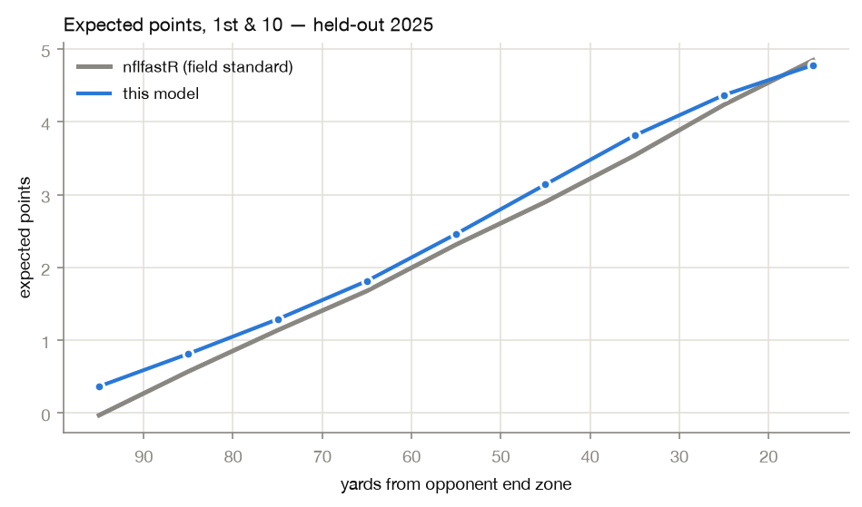
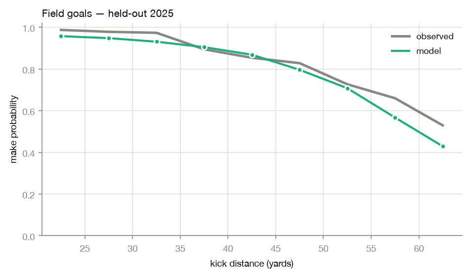
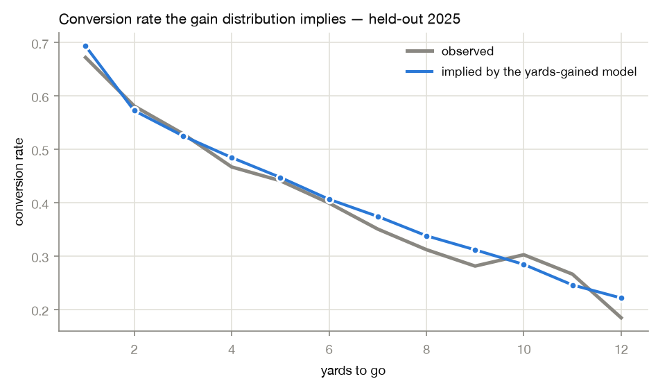

# Validation report

All figures computed on **held-out 2025** — a season no model trained on and
no hyperparameter was selected against. Validation is temporal: train
2016–2023, validate 2024, test 2025.
A random play-level split would leak, because every play in a drive shares
the same next-score label.

Regenerate with `make report`.

## Headline

| Model | Metric | Result | Reference |
|---|---|---|---|
| Next score (7-class) | log loss | **1.2961** | 1.5109 class-prior baseline |
| Next score | accuracy | 44.2% | — |
| Expected points | MAE vs nflfastR | 0.432 pts | r = 0.9568 |
| Win probability | log loss | **0.4858** | nflfastR vegas_wp 0.4781 |
| Win probability | Brier | 0.1628 | nflfastR vegas_wp 0.1595 |
| Win probability | ECE | **0.0274** | — |
| Conversion | ECE | 0.0173 | AUC 0.6993 |
| Field goal | Brier | 0.1146 | AUC 0.7487 |

The next-score model beats the class-prior baseline by
0.215 nats. That baseline is printed on every
training run, because a log loss around 1.3 means nothing on its own.

## Calibration

For a probability model, calibration matters more than discrimination: a model
can rank perfectly and still be systematically overconfident. Expected
calibration error is the sample-weighted mean gap between predicted and
observed rates.

| Predicted | n | Predicted | Observed | Gap |
|---|---|---|---|---|
| 0.0–0.1 | 5,751 | 0.037 | 0.061 | -0.024 |
| 0.1–0.2 | 3,657 | 0.150 | 0.204 | -0.053 |
| 0.2–0.3 | 3,450 | 0.249 | 0.308 | -0.058 |
| 0.3–0.4 | 3,408 | 0.349 | 0.374 | -0.025 |
| 0.4–0.5 | 3,320 | 0.451 | 0.461 | -0.010 |
| 0.5–0.6 | 3,358 | 0.550 | 0.595 | -0.045 |
| 0.6–0.7 | 3,596 | 0.652 | 0.665 | -0.014 |
| 0.7–0.8 | 3,258 | 0.749 | 0.715 | +0.034 |
| 0.8–0.9 | 3,349 | 0.850 | 0.830 | +0.020 |
| 0.9–1.0 | 5,012 | 0.961 | 0.964 | -0.003 |

Win-probability ECE is **0.0274** across 38,159 plays. That number sets
the toss-up threshold in the decision engine: any recommendation resting on a
thinner margin than the model's own error is not a recommendation.

## Benchmark against nflfastR

nflfastR is the field-standard implementation. Its `ep`/`wp` columns are used
**only** as a benchmark here and never as model inputs. Two references are
reported: `wp` ignores the betting market, `vegas_wp` uses the pregame spread.
Ours uses the spread, so `vegas_wp` is the like-for-like comparison.

| Model | log loss | Brier | AUC |
|---|---|---|---|
| This model | **0.4858** | 0.1628 | 0.8426 |
| nflfastR `wp` | 0.5055 | 0.1714 | 0.8220 |
| nflfastR `vegas_wp` | 0.4781 | 0.1595 | 0.8479 |

We beat plain `wp` and lose narrowly to `vegas_wp` on the held-out season.
That is the honest result and it is reported rather than buried.

## Outcome models

Worst distance-bin gap: 0.100. The field-goal model is a
logistic GLM rather than a network — see the README for why the neural version
was withdrawn.

The strongest single piece of evidence in this report. The yards-gained model
is trained only on binned yardage and never sees a convert/fail label, yet the
conversion probability implied by summing its bins above the sticks tracks the
observed rate to within 0.037 at every distance.
Two quantities derived independently agreeing is real evidence the bins mean
what the decision engine assumes they mean.

## Decision engine

The engine has no ground-truth label, so its correctness is argued rather than
scored. `make sanity` asserts it, and all checks pass:

- Nine canonical situations with a settled answer in the literature
  (go on 4th & 1 near midfield, punt on 4th & long from deep) all match.
- Monotonicity: win probability of going for it never rises as yards-to-go
  grows; field-goal value never falls as the kick gets shorter. Largest
  violation +0.0006, tolerance 0.005.
- Every action's win probability lies in [0, 1] across the whole field.

## Applied to history

Scored 41,082 fourth downs, of which 26,923 are meaningful
and outside the toss-up band. The model agrees with the coach 72.0% of
the time, and the average call gives away 0.52 points of win probability.

## Known limitations

- Field-goal accuracy on 55+ yard attempts is under-predicted by roughly 10
  points. League-wide kicking improved faster than the training window
  captured. The error is conservative — it discourages marginal long attempts.
- `dynamic_kickoff_era` and `ot_rules_2025` are constant across the training
  seasons and are dropped automatically. A rule change absent from training
  data cannot be learned.
- Historical scoring is team-neutral and uses a league-average kicker.
- The win-probability task has roughly 4,300 effective independent samples
  (games), not 307k (plays), because the label is shared across a whole game.
  Larger networks overfit it quickly.
